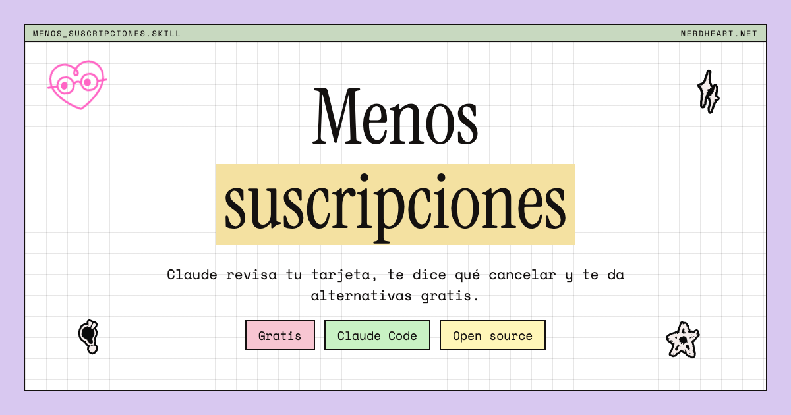
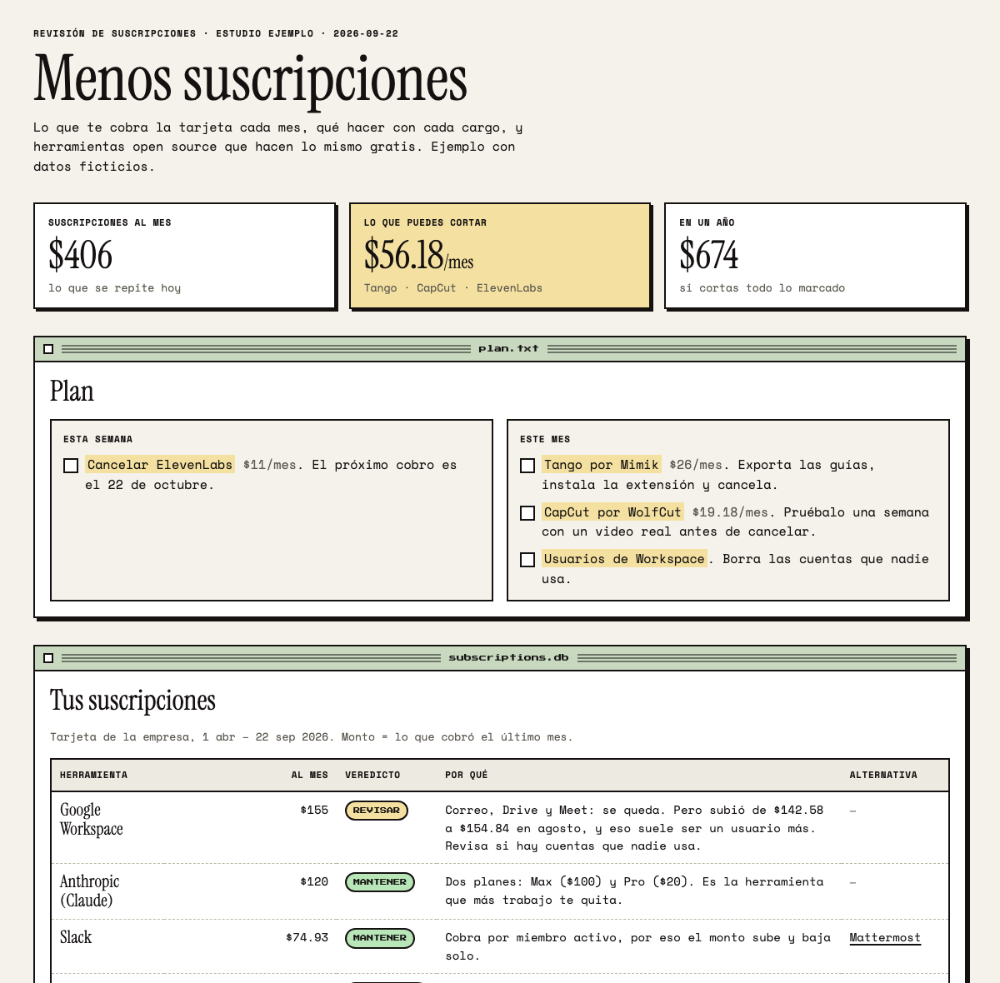
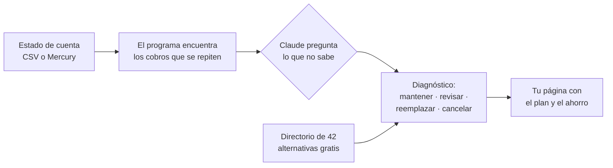

**Español** · [English](README.md)

# Menos suscripciones

Claude revisa lo que te cobra la tarjeta, te dice qué cancelar y te da alternativas gratis.

## Qué es esto

Es una habilidad (skill) para Claude Code, y funciona en español o en inglés: Claude te habla en el idioma en que le escribas. Le pasas el estado de cuenta de tu banco o tu tarjeta y Claude encuentra todos los cobros que se repiten cada mes. Te pregunta lo que no puede adivinar, decide qué se queda y qué se va, y te arma una página con el plan: cuánto pagas hoy, cuánto puedes cortar y qué herramienta gratis hace lo mismo.

## El problema que resuelve

Las suscripciones se acumulan solas. Pruebas una herramienta por un mes, se te olvida, y seis meses después pagas $11 por algo que ya no abres. Revisar el estado de cuenta línea por línea es aburrido, así que nadie lo hace. Con esta skill es una conversación de diez minutos.

## Qué hay adentro

- `.claude/skills/menos-suscripciones/` — las instrucciones que sigue Claude. Es el cerebro del asunto.
- `menos_suscripciones/` — el programa que lee tus transacciones, encuentra lo que se repite y arma la página. No hace falta abrirlo.
- `menos_suscripciones/alternatives.json` — el directorio de 42 herramientas open source y qué reemplaza cada una.
- `examples/` — un estado de cuenta inventado y la página que sale de él, en español y en inglés, para que veas el resultado antes de usar tus datos.
- `tests/` — pruebas automáticas que confirman que las cuentas dan.

## Cómo instalarlo

Necesitas [Claude Code](https://claude.com/claude-code) (la versión de Claude que trabaja con archivos en tu compu). No hace falta instalar nada más: el programa usa el Python que ya trae la Mac.

1. Arriba en esta página, toca el botón verde **Code** y luego **Download ZIP**.
2. Descomprime el ZIP. Te queda una carpeta llamada `menos-suscripciones`.
3. Descarga el estado de cuenta de tu tarjeta en formato CSV. Casi todos los bancos lo tienen en «Exportar» o «Descargar movimientos». Pide al menos 6 meses, y mejor 12.
4. Abre Claude Code dentro de la carpeta `menos-suscripciones`.
5. Escríbele: **«Revisa mis suscripciones con este archivo: »** y arrastra el CSV a la ventana.

Si usas Mercury, en el paso 3 puedes darle a Claude una llave de solo lectura (Mercury → Settings → Tokens) y no tienes que descargar nada.

**Sabrás que funcionó cuando** se abra en tu navegador una página como la de abajo, con tus herramientas y lo que puedes ahorrar.

Tus datos bancarios no salen de tu compu: se guardan en la carpeta `work/`, que nunca se sube a ningún lado.

## Así se ve

Detalles técnicos

- **Stack:** Python 3.9+ solo con librería estándar (sin `pip install`). La página es un único HTML estático con CSS y JS en línea; usa Google Fonts y funciona sin ellas.
- **Cómo funciona:** `python3 -m menos_suscripciones scan` normaliza las transacciones (`loaders.py`) a `Charge(date, description, amount)` con cargos en negativo, agrupa por comercio (`detect.merchant_key`) y escribe `work/scan.json`. Claude lee ese archivo, escribe `work/diagnostico.json` con veredictos y razones, y `render` cruza los dos con el catálogo para generar el HTML.
- **Detección:** la unidad es el mes, no el cargo. Un comercio con cobros en meses consecutivos es mensual (también trimestral o anual por la mediana de la distancia entre meses). Eso resuelve dos planes del mismo proveedor, cobro por uso y recargas de créditos, que rompen la detección por intervalos entre cargos. Los reembolsos se netean en su mes; un comercio con saldo neto positivo es ingreso y se descarta.
- **Separación de responsabilidades:** el modelo nunca hace aritmética. Todo monto de la página sale de `scan.json`; el diagnóstico solo referencia llaves (`keys`), y `render` falla si una llave no existe o un veredicto no es válido.
- **Idiomas:** `"lang": "es" | "en"` en el diagnóstico cambia todas las etiquetas de la página; el catálogo trae los dos idiomas. Los veredictos y estados se aceptan en cualquiera de los dos.
- **Fuentes:** CSV de cualquier banco (detecta separador, columnas en inglés o español, monto único o débito/crédito, fechas día/mes o mes/día, cargos en positivo con aviso), JSON genérico o con la forma de Mercury, y la API de Mercury (`GET /transactions`, Basic Auth, paginado con `start_after`). Se descartan transferencias internas y transacciones fallidas o canceladas.
- **Limitaciones:** solo ve las tarjetas que le pases. Un cobro mensual que apareció una sola vez en el período queda como cargo único. La normalización de comercios es heurística: si dos nombres raros son lo mismo, Claude los junta en el diagnóstico.
- **Pruebas:** `python3 -m unittest discover -s tests`.

## Preguntas y siguientes pasos

- ¿Tu banco exporta un CSV que no lee? Abre un issue con los encabezados del archivo (sin tus movimientos).
- ¿Conoces una alternativa open source buena? Agrégala a `menos_suscripciones/alternatives.json` y manda un pull request.
- Licencia MIT.

## Más herramientas así

Publico herramientas gratis como esta en mi newsletter, [Val en Nerd Heart](https://valatnerdheart.substack.com). Al terminar tu diagnóstico, Claude te pregunta una sola vez si quieres suscribirte; si dices que sí, te abre la página para que lo confirmes tú. Si dices que no, no vuelve a preguntar.

## Quién lo hizo

Lo hice yo, [Valeria Alfuzzi](https://www.valeriaalfuzzi.com), consultora de Notion y arquitecta de sistemas con IA en [Nerd Heart](https://nerdheart.net). Si quieres algo así para tu negocio, o tienes una idea para mejorarlo, escríbeme a [team@nerdheart.net](mailto:team@nerdheart.net) o pasa por [valeriaalfuzzi.com](https://www.valeriaalfuzzi.com).
