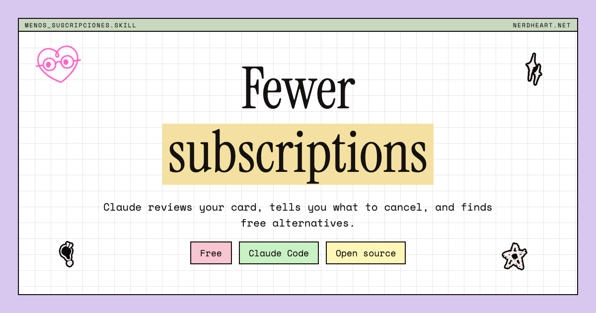
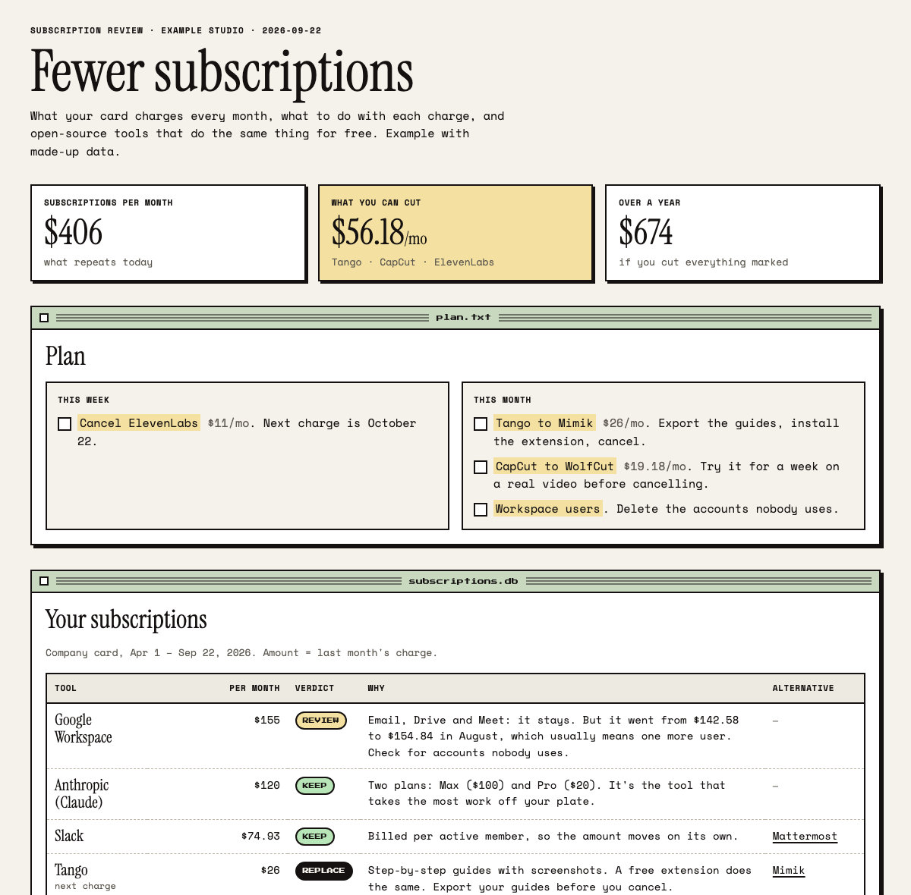
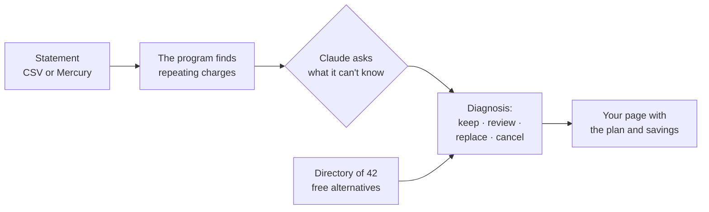

[Español](README.es.md) · **English**

# Menos suscripciones (Fewer subscriptions)

Claude reviews what your card charges you, tells you what to cancel, and finds free alternatives.

## What this is

A skill for Claude Code that works in English or Spanish: Claude answers in whatever language you write in. You hand it your bank or card statement and Claude finds every charge that repeats each month. It asks about what it can't guess, decides what stays and what goes, and builds you a page with the plan: what you pay today, what you can cut, and which free tool does the same job.

## The problem it solves

Subscriptions pile up on their own. You try a tool for a month, forget about it, and six months later you're paying $11 for something you never open. Going through a statement line by line is tedious, so nobody does it. With this skill it's a ten-minute conversation.

## What's inside

- `.claude/skills/menos-suscripciones/` — the instructions Claude follows. This is the brain of it.
- `menos_suscripciones/` — the program that reads your transactions, finds what repeats, and builds the page. You don't need to open it.
- `menos_suscripciones/alternatives.json` — the directory of 42 open-source tools and what each one replaces.
- `examples/` — a made-up statement and the page it produces, in English and Spanish, so you can see the result before using your own data.
- `tests/` — automatic checks that the math adds up.

## How to install it

You need [Claude Code](https://claude.com/claude-code) (the version of Claude that works with files on your computer). Nothing else to install: the program uses the Python that already comes with your Mac.

1. At the top of this page, click the green **Code** button, then **Download ZIP**.
2. Unzip it. You'll get a folder called `menos-suscripciones`.
3. Get your transactions in whatever form your bank gives them: a CSV or Excel export, PDF statements, or even screenshots. Ask for at least 6 months, ideally 12.
4. Open Claude Code inside the `menos-suscripciones` folder.
5. Type: **"Review my subscriptions"**. Claude first asks a few questions in one message (who it's for, what your business does, which tools you can't live without, which bank you use) and tells you the easiest way to hand over your transactions. Then drag your files into the window.

If you bank with Mercury, you can skip the download: Claude opens a small file where you paste a read-only key (Mercury → Settings → Tokens). The key never goes in the chat. Claude never asks for passwords, card numbers or bank logins.

**You'll know it worked when** a page like the one below opens in your browser, with your tools and what you can save.

Your bank data stays on your computer: it's saved in the `work/` folder, which is never uploaded anywhere.

## See it in action

Technical background

- **Stack:** Python 3.9+ standard library only (no `pip install`). The page is a single static HTML file with inline CSS and JS; it uses Google Fonts and works without them.
- **How it works:** `python3 -m menos_suscripciones scan` normalizes transactions (`loaders.py`) into `Charge(date, description, amount)` with charges negative, groups them by merchant (`detect.merchant_key`), and writes `work/scan.json`. Claude reads that file and writes `work/diagnosis.json` with verdicts and reasons; `render` joins both with the catalog to produce the HTML.
- **Detection:** the unit is the month, not the charge. A merchant charging in consecutive months is monthly (quarterly or annual from the median gap between active months). That handles two plans from the same vendor, usage-based billing and credit top-ups, which break detection based on the interval between charges. Refunds net into their month; a merchant with a positive net balance is income and is dropped.
- **Separation of concerns:** the model never does arithmetic. Every amount on the page comes from `scan.json`; the diagnosis only references keys, and `render` fails on an unknown key or verdict.
- **Languages:** `"lang": "en" | "es"` in the diagnosis switches every label on the page; the catalog carries both languages. Verdicts and statuses are accepted in either language.
- **Sources:** a CSV from any bank (detects delimiter, English or Spanish headers, single amount or debit/credit columns, day/month or month/day dates, positive charges with a warning), generic JSON or Mercury-shaped JSON, and the Mercury API (`GET /transactions`, Basic Auth, paginated with `start_after`). Internal transfers and failed or cancelled transactions are dropped. PDF statements, screenshots and email receipts are transcribed by Claude into the JSON format; `scan` prints total charges per month so the transcription can be checked against the statement's own totals.
- **Limitations:** it only sees the cards you give it. A monthly charge that appeared once in the period is listed as a one-off. Merchant normalization is heuristic: when two odd names are the same tool, Claude merges them in the diagnosis.
- **Tests:** `python3 -m unittest discover -s tests`.

## Questions and next steps

- Does your bank export a CSV it can't read? Open an issue with the file's headers (not your transactions).
- Know a good open-source alternative? Add it to `menos_suscripciones/alternatives.json` and send a pull request.
- MIT license.

## More tools like this

I publish free tools like this one in my newsletter, [Val en Nerd Heart](https://valatnerdheart.substack.com) (in Spanish). When your diagnosis is done, Claude asks once whether you'd like to subscribe; if you say yes, it opens the page so you confirm it yourself. If you say no, it won't ask again.

## Who made it

Me, [Valeria Alfuzzi](https://www.valeriaalfuzzi.com), a Notion consultant and AI systems architect at [Nerd Heart](https://nerdheart.net). If you want something like this for your business, or have an idea to make it better, email me at [team@nerdheart.net](mailto:team@nerdheart.net) or visit [valeriaalfuzzi.com](https://www.valeriaalfuzzi.com).
